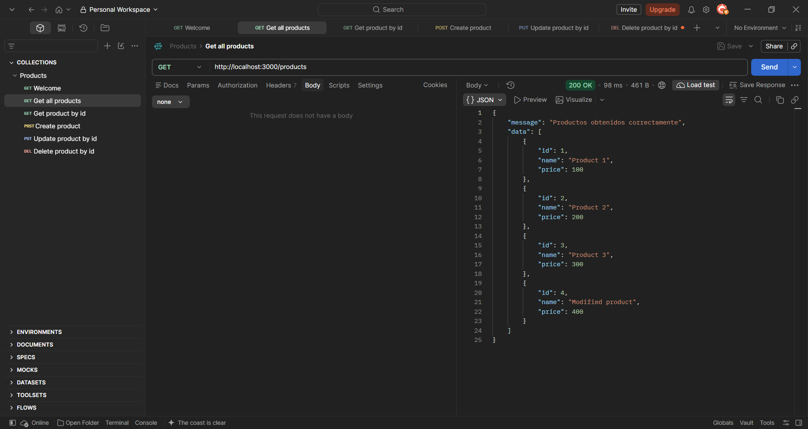
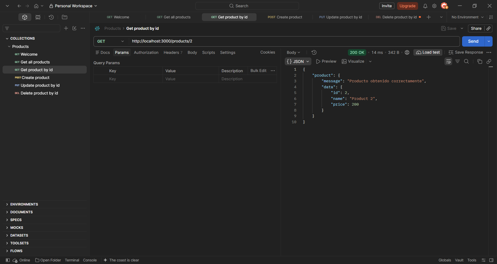

# Diplomatura en Profesional Full-Stack Developer

## Curso de desarrollo con Node JS - Profesor: Gabriel Alberini

### Módulo 1: Node JS

### Unidad 2: ExpressJS

### Tarea 2: Mi primer API REST con Express

### Objetivos:

Aprender a instalar y configurar un proyecto con Express.

Definir rutas RESTful y utilizar Postman para probarlas.

### Capturas de pantallas:







### Pasos para la ejecución local:

1. Clonar el repositorio:

```bash
git clone https://github.com/Diplomatura-Full-Stack-Developer/Node-M1-T2
```

2. Instalar las dependencias:

```bash
npm install
```

3. Ejecutar el script:

```bash
node server.js
```

### Recursos utilizados:

- Node JS - Versión 24.20.0 ([https://nodejs.org/es/download/](https://nodejs.org/es/download/))
- Npm - Versión 12.0.2 (instalado por defecto con Node JS)
- Express - Versión 5.3.0 ([https://www.npmjs.com/package/express](https://www.npmjs.com/package/express))
- Postman - Versión 12.33.2 ([https://www.postman.com/](https://www.postman.com/))

### Alumno: Rubén Seco

### Comisión: 181806
