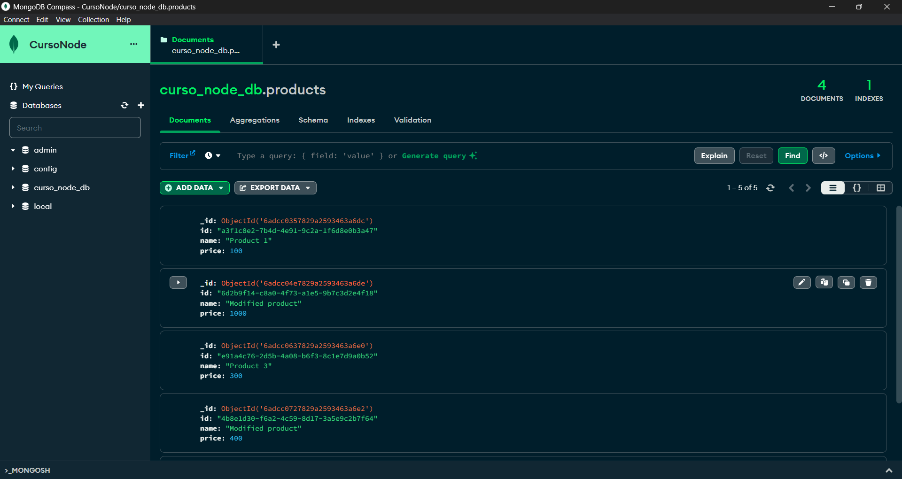
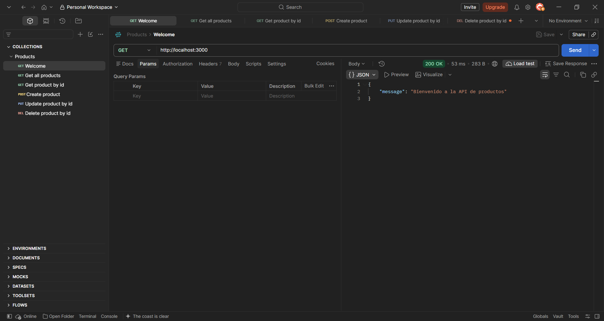
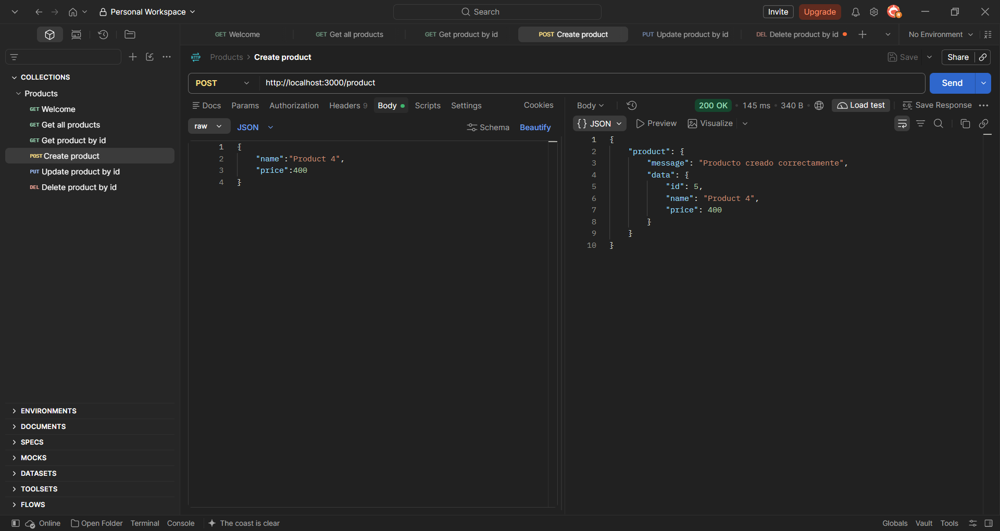
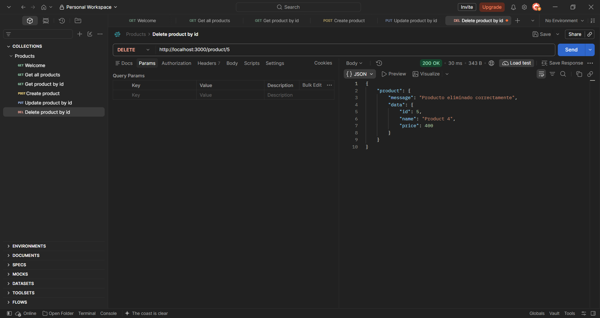
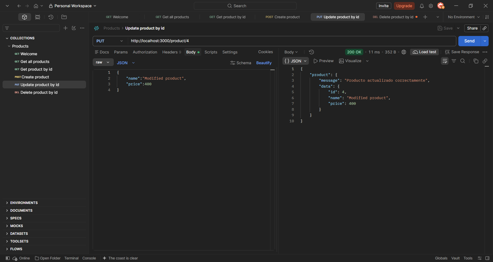

# Diplomatura en Profesional Full-Stack Developer

## Curso de desarrollo con Node JS - Profesor: Gabriel Alberini

### Módulo 1: Node JS

### Unidad 3: MongoDB

### Tarea 3: Integrando Mongoose en mi API.

### Objetivos:

Conectar la API en Express a una base de datos MongoDB utilizando Mongoose.

Definir un esquema y realizar operaciones CRUD básicas.

### Consideraciones:

- Se crea un servidor con Express y se definen las rutas RESTful para el manejo de productos.
- Se crea un archivo server.js para el servidor.
- Se crea un archivo dbconnection.js para la conexión a la base de datos MongoDB.
- Se puede acceder a la base de datos MongoDB utilizando MongoDB Compass.
- Se crea un archivo model.js para el esquema de los productos.
- Se crea un archivo .env.template para las variables de entorno.
- Se crea un archivo router.js para las rutas de la API.
- Se crea un archivo controller.js donde se implementan las rutas RESTful para el manejo de productos.
- Se crea un archivo service.js donde se implementan las funciones para el manejo de productos, con el objetivo de abstraer la lógica de negocio.
- Se pueden cargar datos en base desde el archivo products.json. De cualquier manera, la base de datos se creará de forma automática al crear un primer producto.
- Con la division de responsabilidades de los archivos creados, se logra una arquitectura limpia y mantenible.
- Se utiliza Postman para probar las rutas.

### Capturas de pantallas:












### Pasos para la ejecución local:

1. Clonar el repositorio:

```bash
git clone https://github.com/Diplomatura-Full-Stack-Developer/Node-M1-T3
```

2. Instalar las dependencias:

```bash
npm install
```

3. Ejecutar el script:

```bash
node server.js
```

### Recursos utilizados:

- Node JS - Versión 24.20.0 ([https://nodejs.org/es/download/](https://nodejs.org/es/download/))
- Npm - Versión 12.0.2 (instalado por defecto con Node JS)
- Express - Versión 5.3.0 ([https://www.npmjs.com/package/express](https://www.npmjs.com/package/express))
- Mongoose - Versión 9.11.3 ([https://www.npmjs.com/package/mongoose](https://www.npmjs.com/package/mongoose))
- MongoDB Compass - Versión 1.40.4 ([https://www.mongodb.com/es/products/compass](https://www.mongodb.com/es/products/compass))

### Alumno: Rubén Seco

### Comisión: 181806
